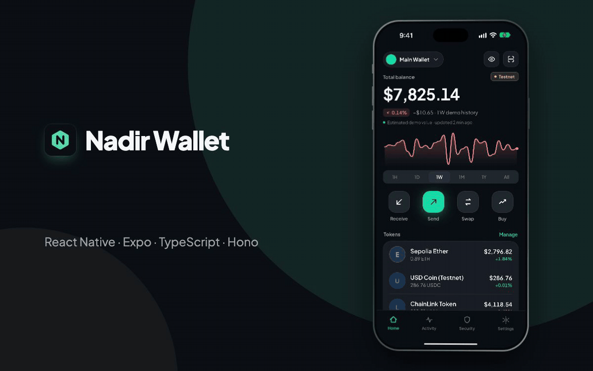
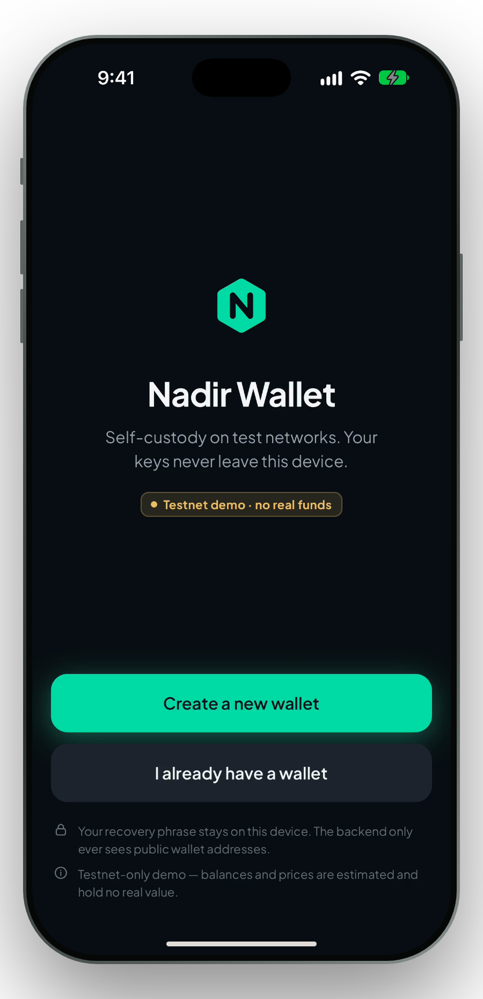
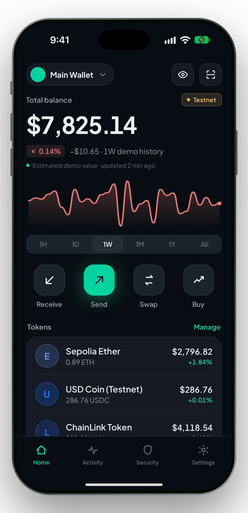
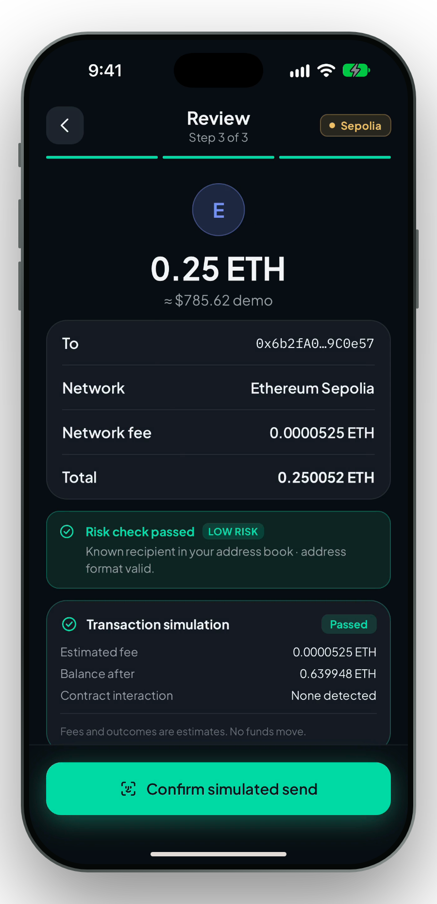
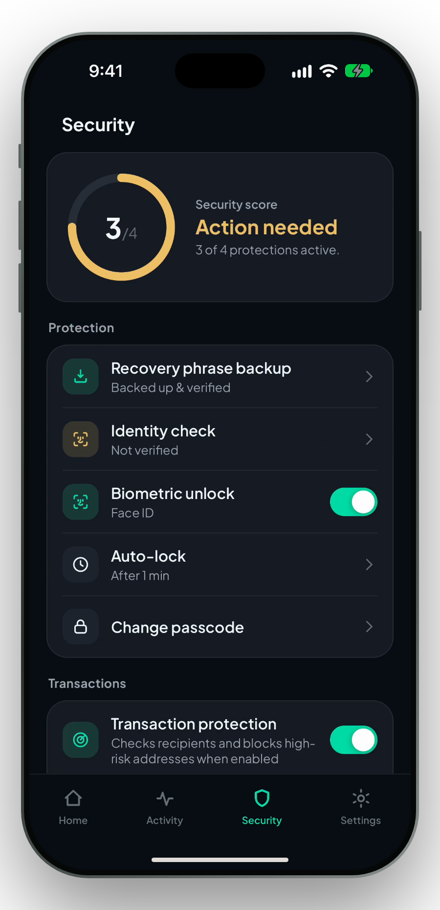
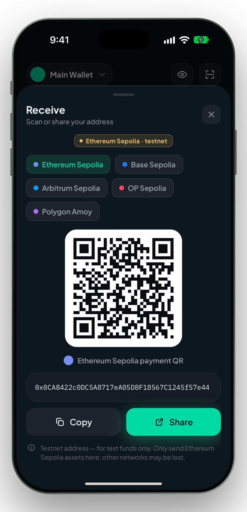
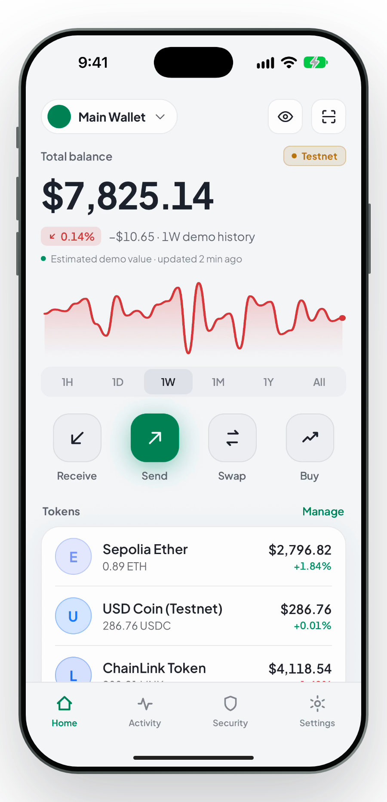
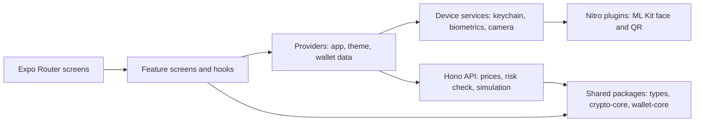

# Nadir Wallet

[](https://github.com/naderalfakesh/nadir-wallet/actions/workflows/ci.yml)

**A self-custody crypto wallet for practising on test networks: your keys stay on your phone, every send is checked before it leaves, and no real money is involved.**

Nadir Wallet is a portfolio project by [Nadir Alfakesh](https://naderalfakesh.com):
one person taking a product from design to a tested, working app on iPhone and
Android. It is testnet-only, sends are simulated, and balances, prices and
history are sample data.

<p align="center">
  
</p>

<p align="center">
  <a href="docs/nadir-wallet-promo.mp4"><strong>▶ Watch the 80-second walkthrough with sound</strong></a>
</p>

## At a glance

- **A complete product, not a screen mock-up.** Creating or importing a wallet,
  backing it up, locking it, sending, receiving and browsing history all work
  end to end.
- **Safe to try.** It runs on test networks only and sends are simulated, so
  nothing in it can move real money.
- **Security comes first.** The recovery phrase never leaves the phone, the app
  locks behind a passcode and Face ID or fingerprint, and risky recipients are
  blocked before a send.
- **Real native engineering.** The QR scanner and the face check are
  hand-written camera modules in Swift and Kotlin, not off-the-shelf plugins.
- **Tested like production software.** 401 automated tests run on every change,
  plus an end-to-end suite that drives the Android app.
- **One codebase, two platforms.** The same React Native code ships to iOS and
  Android.

## Screens

| Welcome                                                                                                                         | Portfolio                                                                                                                               | Send review                                                                                                                                                 |
| ------------------------------------------------------------------------------------------------------------------------------- | --------------------------------------------------------------------------------------------------------------------------------------- | ----------------------------------------------------------------------------------------------------------------------------------------------------------- |
|  |  |  |

| Security Center                                                                                                                                           | Receive                                                                                                                                | Light theme                                                                                      |
| --------------------------------------------------------------------------------------------------------------------------------------------------------- | -------------------------------------------------------------------------------------------------------------------------------------- | ------------------------------------------------------------------------------------------------ |
|  |  |  |

## What you can do in it

- **Set up a wallet** — create a new one or import a 12 or 24-word recovery
  phrase, verify your backup, and choose a passcode.
- **Explore your portfolio** — scrub the balance chart, switch time ranges, and
  open any token for its details.
- **Send with a safety net** — pick or scan a recipient, see an address risk
  check and a simulation of the transaction, then confirm with Face ID or
  fingerprint. Reported addresses are blocked.
- **Receive** — show a payment QR code for any of five test networks, or copy
  and share the address.
- **Find a transaction** — search activity by name, token or address and
  filter by type.
- **Stay protected** — a security score, auto-lock, biometric unlock, and an
  optional on-device face check for sensitive actions.
- **Make it yours** — dark or light theme, display currency, hidden balances,
  and demo controls that let a reviewer try outages and failed sends.

The QR scanner and the face check need a real camera, so they run on a
physical device; everything else also runs in the iOS Simulator.

## How it is built

For engineers: the short version of what is under the hood.

| Area     | Choice                                                                                   |
| -------- | ---------------------------------------------------------------------------------------- |
| App      | React Native 0.88, React 19, Expo SDK 58, TypeScript (strict)                            |
| Routing  | Expo Router with typed routes                                                            |
| Native   | Two VisionCamera 5 frame-processor plugins (Nitro Modules, Swift and Kotlin) over ML Kit |
| Crypto   | `viem`, `@scure/bip39`, `@noble/hashes`; secrets in `expo-secure-store`                  |
| Backend  | Hono on Node, libsql with Drizzle ORM, Zod validation                                    |
| Monorepo | pnpm workspaces and Turborepo, with shared `types`, `crypto-core` and `wallet-core`      |
| Quality  | Vitest, an Android end-to-end suite, ESLint, Prettier, GitHub Actions                    |



Decisions worth a look:

- **Keys never leave the device.** BIP39 phrases are generated or imported
  on-device and kept in the keychain. The API only ever receives public
  addresses, network IDs and unsigned drafts
  ([security model](docs/security-model.md)).
- **Camera work on the frame thread.** Two hand-written native modules run
  Google ML Kit inside the camera pipeline: [face liveness](packages/face-liveness)
  and [QR scanning](packages/code-scanner).
- **A face check you can test.** The liveness challenge (blink, turn, nod,
  smile, in random order) is a pure reducer, so every path has a unit test
  ([state machine](apps/mobile/src/features/liveness/livenessChallenge.machine.ts)).
- **Sensitive actions sit behind the OS.** Revealing the phrase requires Face
  ID, fingerprint or the device passcode and fails closed; the app passcode is
  a salted PBKDF2 hash with an escalating lockout that survives a relaunch.
- **Layering is enforced.** Each feature owns its screens, hooks and tests, and
  an ESLint rule stops shared layers from importing features, providers or
  routes ([architecture](docs/architecture.md)).
- **Native build fixes.** A config plugin patches ML Kit so simulator builds
  work on Apple Silicon, and Android release builds keep the classes R8 would
  strip ([build notes](docs/verification/expo-sdk-58.md)).

**Tests:** `pnpm test` runs 40 Vitest files with 401 tests over the wallet
logic, the security flows and the shared packages. CI runs the format check,
lint, type check and tests on every push to `main` and every pull request. A
separate end-to-end suite of three tests drives a release build on Android, and
the release APK was checked by hand on a
[Pixel 9](docs/verification/device-pixel9-android.md).

```text
apps/mobile/             React Native app (Expo Router, feature folders)
apps/api/                Hono API (libsql + Drizzle)
packages/types/          Shared request, response and domain types
packages/crypto-core/    Address, BIP39 and passcode helpers
packages/wallet-core/    Risk scoring, simulation, portfolio logic
packages/face-liveness/  Native ML Kit face detection plugin (Nitro)
packages/code-scanner/   Native ML Kit barcode scanning plugin (Nitro)
docs/                    Security model, architecture, API reference
```

## Run it locally

No accounts or keys are needed; the API serves sample data.

```sh
pnpm install

# Terminal 1: the API on http://localhost:8787
pnpm dev:api

# Terminal 2: build and run the app
pnpm --filter @nadir-wallet/mobile ios      # or: android
```

<details>
<summary>Prerequisites, environment notes and commands</summary>

- Node.js 22.13 or newer and pnpm 11.
- iOS: Xcode 27 with CocoaPods. Android: Android Studio with an SDK and a
  JDK 17.
- Expo Go is not supported; the app uses development builds because of its
  native camera modules.
- If the API is not running, the app falls back to bundled sample data. You
  can also switch the data source in Settings, under Demo controls.
- On a physical device `localhost` does not resolve. Copy
  `apps/mobile/.env.example` to `apps/mobile/.env` and set
  `EXPO_PUBLIC_API_URL` to your computer's LAN address.
- Server-only settings live in `apps/api/.env` (see `apps/api/.env.example`).
  Never put an RPC key in an `EXPO_PUBLIC_*` variable; those ship inside the
  app bundle.

| Command          | Purpose                                     |
| ---------------- | ------------------------------------------- |
| `pnpm dev:api`   | Run the API with migrations and seed data   |
| `pnpm test`      | Run the unit tests                          |
| `pnpm lint`      | Lint every workspace                        |
| `pnpm typecheck` | Type-check every workspace                  |
| `pnpm test:e2e`  | Run the Android end-to-end suite (QA build) |

What it does not do yet: real signing or broadcast, mainnet, live prices or an
on-chain indexer, WalletConnect and swaps. The face check is challenge-based
only and is documented as a threat model, not as production-grade
anti-spoofing.

End-to-end setup (QA build, device, API port) is in the
[mobile README](apps/mobile/README.md#end-to-end-tests). More detail: the
[API README](apps/api/README.md), the [API reference](docs/api.md) and the
[architecture notes](docs/architecture.md).

</details>

## License

[MIT](LICENSE).
