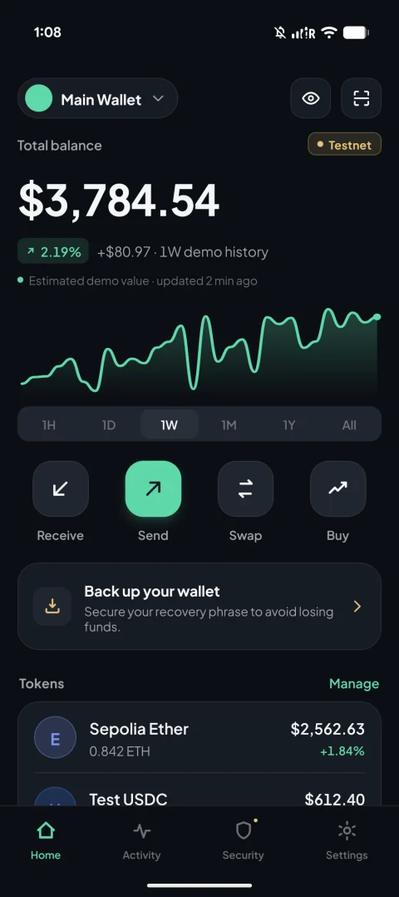
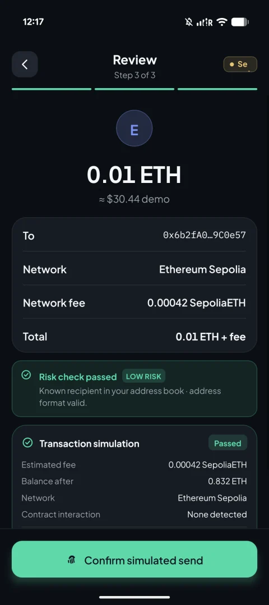
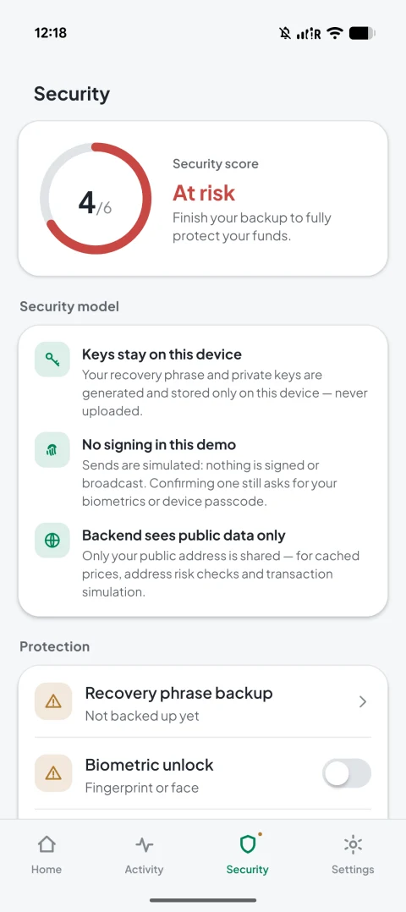
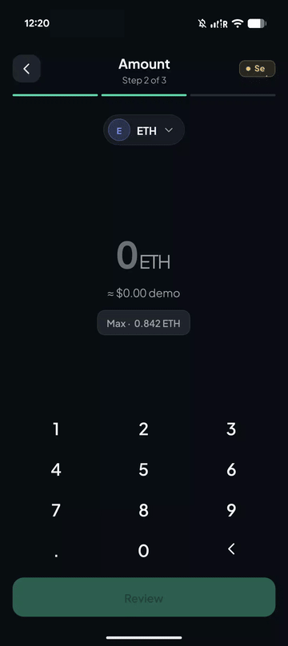

# Nadir Wallet

[](https://github.com/naderalfakesh/nadir-wallet/actions/workflows/ci.yml)

A **local-first, non-custodial, testnet-only** wallet built with React Native, Expo and Hono. Sends are simulated, and balances, prices and history use sample data.

<p>
  
  
  
</p>

## What you can try

- Create or import a test wallet, set an app passcode, and unlock with the passcode or device biometrics.
- Scan a payment QR or enter a recipient. Review address risk and the estimated fee before confirming a simulated send.
- Pass an on-device face-liveness identity check during setup, then manage backup, biometrics and transaction protection in the Security tab.
- Use **Settings → Demo controls** to try API outages and different send outcomes.

## Engineering highlights

- **Native camera processing.** Two Swift and Kotlin Nitro modules run Google ML Kit on the VisionCamera frame thread. [Face liveness](packages/face-liveness) and [QR scanning](packages/code-scanner).
- **Active liveness.** The face check advances through randomized prompts with a deterministic reducer. [Challenge state machine](apps/mobile/src/features/liveness/livenessChallenge.machine.ts).
- **Native build fixes.** A config plugin patches ML Kit's Mach-O load commands for Apple Silicon simulators. Android release builds preserve the Nitro JNI classes and ML Kit registrar constructors through R8. [Simulator patch](apps/mobile/plugins/mlkit-sim-patch.py) and [Android build notes](docs/verification/expo-sdk-58.md#r8-keep-rules).
- **Local key custody.** BIP39 phrases are generated or imported on-device and stored in SecureStore. The API receives public addresses, network IDs and unsigned transaction drafts. [Security model](docs/security-model.md).

## Demo

<details>
  <summary>Watch the Android Send review</summary>
  
</details>

The iOS Simulator supports the portfolio, onboarding, lock, and simulated-send flows. The live QR scanner and face-liveness challenges require a physical device with a camera. See the [Pixel 9 device results](docs/verification/device-pixel9-android.md).

## Tech stack

| Area    | Choices                                                                                                                                                                     |
| ------- | --------------------------------------------------------------------------------------------------------------------------------------------------------------------------- |
| Mobile  | React Native 0.88 (Expo SDK 58), expo-router, TypeScript, react-native-svg                                                                                                  |
| Crypto  | `viem/accounts` (generation/derivation), `@scure/bip39` (validation), `@noble/hashes` (PIN hashing), `react-native-get-random-values`                                       |
| Storage | `expo-secure-store` (secrets), `@react-native-async-storage/async-storage` (prefs)                                                                                          |
| Device  | `expo-local-authentication`, `expo-clipboard`, `expo-haptics`, `react-native-qrcode-svg`                                                                                |
| Native  | Two custom VisionCamera V5 frame-processor plugins (Nitro Modules, Swift/Kotlin) over Google ML Kit: `face-liveness` (Face Detection) and `code-scanner` (Barcode Scanning) |
| Backend | Hono + `@hono/node-server`, libsql + Drizzle ORM, Zod, viem                                                                                                                 |
| Shared  | `@nadir-wallet/{types,crypto-core,wallet-core,config}`                                                                                                                      |
| Tooling | Turborepo, pnpm 11, Vitest, GitHub Actions                                                                                                                                  |

## Monorepo structure

```
apps/
  mobile/                # React Native app (Expo SDK 58, expo-router)
  api/                   # Hono backend API (libsql + Drizzle)
packages/
  types/                 # @nadir-wallet/types: shared response/domain types
  crypto-core/           # @nadir-wallet/crypto-core: address, BIP39, and passcode helpers
  wallet-core/           # @nadir-wallet/wallet-core: risk, simulation, portfolio logic
  face-liveness/         # @nadir-wallet/face-liveness: native ML Kit Face Detection plugin (Nitro)
  code-scanner/          # @nadir-wallet/code-scanner: native ML Kit Barcode Scanning plugin (Nitro)
  config/                # @nadir-wallet/config: shared tsconfig / eslint / prettier
docs/
  security-model.md      # trust boundary, what is and is never sent to the API
  architecture.md        # layers, data flow, design decisions
  api.md                 # endpoint request/response reference
```

Mobile follows a feature-based layout under `apps/mobile/src` (`app/` routes,
`features/`, `components/`, `providers/`, `services/`, `theme/`, `i18n/`).

## Requirements

- Node.js >= 22.13
- pnpm 11
- Xcode 27 and/or Android Studio for native builds

## Getting started

```sh
pnpm install
```

### Run the API

```sh
pnpm dev:api          # http://localhost:8787, runs migrations + seeds on boot
```

### Run the mobile app

```sh
pnpm --filter @nadir-wallet/mobile start   # then press i (iOS) / a (Android)
```

Run the API first so the app can fetch live public data. If it is down, the app
quietly falls back to bundled sample data (choose the data source in Settings,
Demo controls).

The camera features need a development build (`pnpm --filter
@nadir-wallet/mobile ios` or `android`); everything else also runs in the iOS
Simulator (on Xcode 27, Expo CLI opens it in Device Hub). ML Kit does not ship
an arm64 simulator slice, so a small config plugin
(`apps/mobile/plugins/withMlkitSimulatorFix.js`) patches the pods after each
install to keep simulator builds working on Apple Silicon with Xcode 26 and
later.
See the [mobile README](apps/mobile/README.md) for details.

## Environment setup

Copy the example files (sensible defaults are built in, so this is optional for
local dev):

```sh
cp apps/api/.env.example apps/api/.env
cp apps/mobile/.env.example apps/mobile/.env
```

**API (`apps/api/.env`)**, server-only and never bundled into the app:

```env
PORT=8787
DATABASE_URL=file:./local.db
RPC_URL_ETHEREUM_SEPOLIA=
RPC_URL_POLYGON_AMOY=
```

**Mobile (`apps/mobile/.env`)**, public config only (`EXPO_PUBLIC_*` is embedded
in the JS bundle):

```env
EXPO_PUBLIC_API_URL=http://localhost:8787
APPLE_TEAM_ID=            # optional, used by app.config.js for device signing
```

On a **physical device** `localhost` won't resolve, so set `EXPO_PUBLIC_API_URL`
to the dev machine's LAN address (e.g. `http://192.168.1.20:8787`).

### Adding Alchemy / RPC URLs (backend only)

Real RPC is **not wired up yet**: the API serves deterministic mock balances,
prices, and history (see the roadmap). When real RPC is added, provider URLs go
**only** in `apps/api/.env`:

```env
RPC_URL_ETHEREUM_SEPOLIA=https://eth-sepolia.g.alchemy.com/v2/YOUR_KEY
RPC_URL_POLYGON_AMOY=https://polygon-amoy.g.alchemy.com/v2/YOUR_KEY
```

> **Never** put an RPC/Alchemy key in an `EXPO_PUBLIC_*` variable. Those ship
> inside the mobile bundle and are public. RPC keys stay server-side, behind the
> API, by design.

## Current MVP features

- On-device **BIP39** wallet generation and import with real word/checksum
  validation; EVM address derived at `m/44'/60'/0'/0/0`.
- Recovery phrase stored only in the device keychain (SecureStore); revealing or
  backing it up requires OS authentication (Face ID / Touch ID, Android
  biometrics, or the device passcode as the system fallback) and fails closed
  when none is set up. Simulated sends ask for the same confirmation, and fall
  back to the app passcode only on a device with no screen lock at all; passing
  it does not sign or broadcast anything.
- Onboarding, biometric/passcode lock with auto-lock on background, and a local
  append-only security event log. The app-lock PIN is stored as a salted
  PBKDF2 hash, and failed attempts trigger an escalating lockout that survives
  a relaunch.
- Home dashboard, token detail, activity, receive (real QR), send flow with
  backend-backed **address risk check** and **transaction simulation**, security
  center, and settings.
- Live API wiring with graceful demo-data fallback; clipboard and share
  actions.
- Dark + light themes, persisted preferences, English i18n scaffold.
- **Active face-liveness check**: randomized blink / turn / nod / smile
  challenges verified in real time by a hand-written native frame-processor
  plugin (`packages/face-liveness`) running ML Kit on the camera worklet thread,
  with a live face-in-oval gate, fully on-device (see `docs/security-model.md`
  for the threat model). It can optionally **gate revealing the recovery phrase
  and high-value sends** (toggles in the Security Center).
- **QR address scanner** in the send flow, backed by a second hand-written
  native plugin (`packages/code-scanner`) wrapping ML Kit Barcode Scanning.

## Testing & quality

Unit tests (Vitest) target the logic where a regression would be silent:

- the **face-liveness challenge state machine** (`reduceLiveness`, a pure
  reducer): alignment gating, every challenge type, timeouts, and face-loss
  restarts
- **BIP39** word/checksum validation, EVM address derivation, and the
  **passcode hashing** record format (`crypto-core`)
- **address-risk scoring** and **transaction simulation** (`wallet-core`)
- the **passcode lockout policy**, QR address extraction, and the one-shot scan
  channel
- the **OS authentication gate** (mocked): the phrase is read only after a
  successful prompt; cancel, failure, lockout and missing enrolment never read it
- send input validation, simulation-status mapping, security score tiers, and
  transaction display helpers

```sh
pnpm test
```

GitHub Actions runs lint, typecheck, and the test suite on every push.

Vitest covers shared logic and mocks device APIs. The Android e2e suite
covers passcode unlock after restart, Send review with a backend fee, and
switching to demo data and changing the Receive QR network. It uses the
separate **Nadir Wallet QA** app and clears its data between tests.

The e2e suite requires Node 22.22.3+ on the 22.x line or Node 24.8+. Build the
QA variant from the repository root.

```sh
NADIR_E2E=1 pnpm --filter @nadir-wallet/mobile exec expo prebuild --platform android --no-install
NADIR_E2E=1 apps/mobile/android/gradlew -p apps/mobile/android assembleRelease -PreactNativeArchitectures=arm64-v8a
```

Run `pnpm dev:api` in a separate terminal. With the Pixel connected, set
`ANDROID_SERIAL` to its ADB transport, install the QA build, and forward the
app's default API port to the Mac.

```sh
adb -s "$ANDROID_SERIAL" reverse tcp:8787 tcp:8787
agent-device install apps/mobile/android/app/build/outputs/apk/release/app-release.apk --serial "$ANDROID_SERIAL"
agent-device close
pnpm test:e2e
```

Use `agent-device reinstall com.nadiralfakesh.nadirwallet.qa <apk>` for
later builds. Set `NADIR_E2E_DEVICE` to select another Android device by name.
For an emulator, build with its ABI and configure the app's API URL.

The Android release APK passed the previous physical-device run on a [Pixel 9](docs/verification/device-pixel9-android.md). Physical iPhone camera verification is pending.

## Current limitations

- **Testnet-only** (Ethereum Sepolia, Polygon Amoy); no mainnet.
- **No real signing or broadcast.** The send flow simulates and shows
  pending/success/failed outcomes via a demo control; nothing is signed or
  broadcast, and no transaction hash is shown for a simulated send.
- Balances, prices, and history are **deterministic mock data** from the API (no
  real RPC/indexer yet). History entries carry sample hashes, are labelled as
  sample data, and have no block-explorer link.
- Liveness is **active-only** (challenge-response); no passive anti-spoofing.
  This is documented as a threat model, not claimed as production-grade.
- No WalletConnect, no swaps.
- SecureStore protects secrets with the OS keychain/Keystore but adds no extra
  app-level encryption. The reveal prompt is enforced by the app, not bound to
  the keychain item (see `docs/security-model.md`).
- The face-liveness and QR-scanner features need a **development build** and a
  real camera, so they only run on a physical device.

## Roadmap

- Real testnet transaction signing (on-device, from the stored mnemonic)
- Optional testnet broadcast
- Real price API + real transaction indexer (Alchemy/RPC)
- Passive anti-spoofing (PAD) layered under the active liveness check
- Stronger encrypted-vault model
- WalletConnect

## Docs

- [`docs/security-model.md`](docs/security-model.md): trust boundary & secrets
- [`docs/architecture.md`](docs/architecture.md): layers & data flow
- [`docs/api.md`](docs/api.md): endpoint reference
- [`apps/mobile/README.md`](apps/mobile/README.md): running and building the app
- [`apps/api/README.md`](apps/api/README.md): API specifics
- [`packages/face-liveness/README.md`](packages/face-liveness/README.md): native ML Kit liveness plugin (Nitro)
- [`packages/code-scanner/README.md`](packages/code-scanner/README.md): native ML Kit QR scanner plugin (Nitro)

## Workspace scripts

```sh
pnpm dev            # turbo run dev across all apps
pnpm dev:api        # backend only
pnpm dev:mobile     # mobile only
pnpm lint           # turbo run lint
pnpm typecheck      # turbo run typecheck (all packages + apps)
pnpm test           # vitest run (packages + app logic)
pnpm format         # prettier across the repo
```

## Notes

- pnpm uses a hoisted `node_modules` (`nodeLinker` in `pnpm-workspace.yaml`) so
  React Native native modules resolve correctly in the monorepo.
- The `@nadir-wallet/*` packages export raw `.ts`; Metro is configured to watch
  the repo root and resolve package exports (`apps/mobile/metro.config.js`), and
  the API bundles them into its dist with tsup.
